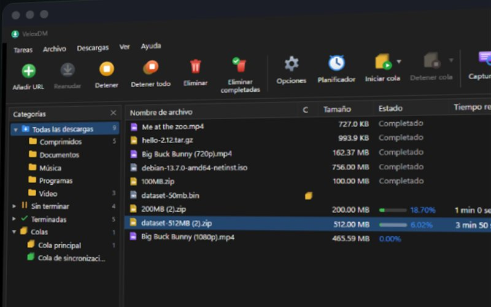
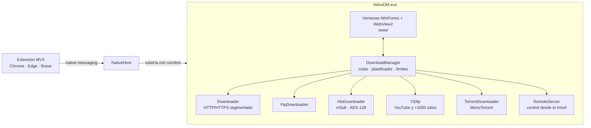

Gestor de descargas con segmentación dinámica, colas, planificador, video, BitTorrent y extensión de navegador.

<a href="https://github.com/Softsoto/VeloxDM/releases/latest"><b>Descargar gratis</b></a> · <a href="https://sotomontes.com/#veloxdm">Ver en sotomontes.com</a> · <a href="#cómo-se-usa">Cómo se usa</a> · <a href="#cómo-funciona-por-dentro">Cómo funciona</a> · <a href="#novedades">Novedades</a>

| Ficha técnica | |
|---|---|
| **Autor** | Sebastian Sotomontes |
| **Tipo** | Gestor de descargas |
| **Plataforma** | Windows 10 y 11 |
| **Versión** | 0.5.2 |
| **Estado** | Funcional |
| **Stack** | C# · .NET 10 · WebView2 |
| **Precio** | Gratis |
| **Código** | Privado. El instalador se descarga desde Releases. |

---

## Qué es

VeloxDM es un gestor de descargas para Windows pensado para bajar archivos grandes sin perder el progreso. Divide cada descarga en varias conexiones que trabajan en paralelo y, cuando una termina, ayuda a la más lenta. También baja vídeo, torrents y paquetes de enlaces, y se integra con tu navegador para capturar las descargas sin que tengas que copiar nada.

## Novedades

- Si un sitio exige una verificación, la descarga abre tu navegador para que la resuelvas tú.
- Tabla de 1311 sitios de alojamiento y motores por plataforma.
- Capturador de enlaces propio con complementos por sitio.
- Barra de progreso de vídeo con el tamaño total desde el inicio.

## Cómo se usa

1. Instala VeloxDM y añade la extensión a tu navegador. Desde ese momento las descargas se capturan solas, con su sesión, cookies y referer.
2. Para bajar algo a mano, pulsa **Añadir URL**, pega el enlace y elige carpeta y categoría. En los vídeos eliges también la calidad.
3. Sigue el avance en la ventana principal. Al abrir una descarga ves cómo progresa cada conexión y puedes pausarla o cambiar su velocidad.
4. Agrupa las descargas en **colas** y abre el **planificador** para decidir qué días y a qué horas corren, y qué hacer al terminar.
5. Para muchos enlaces, pega un texto o una página en el **capturador de enlaces**: revisa cuáles siguen vivos y los agrupa en paquetes con su carpeta y contraseña.
6. En **Opciones** configuras límites, cuota de datos, velocidad por horario, proxy, sonidos y control desde el móvil.

 Ventana principal

 Progreso por conexiones

 Elegir calidad de un vídeo

 Límites y horarios

## Funciones

- **HTTP, HTTPS y FTP** con hasta 32 conexiones y segmentación dinámica.
- **Vídeo** de YouTube y más de 1000 sitios, con calidad a elegir, MP4 o solo audio, además de HLS y DASH.
- **BitTorrent**: enlaces magnet y archivos `.torrent`, con selección de archivos.
- **Extensión de navegador** para Chrome, Edge, Brave, Vivaldi y Opera.
- **Colas y planificador** con días, horas y acciones al terminar.
- **Capturador de enlaces** y paquetes con carpeta y contraseña.
- **Después de descargar**: verificación de sumas, descompresión y antivirus.
- **Control desde el móvil** en la red local con PIN.

## Detalles

- Reanuda tras cortes de internet, reinicios o apagones.
- Hasta 32 conexiones por archivo con segmentación dinámica.
- Los archivos por partes se descomprimen solos al terminar, probando tu lista de contraseñas.
- Si un sitio pide una verificación, VeloxDM abre la página para que la resuelvas tú; nada se salta.
- Línea de comandos para usarlo desde scripts.

## Cómo funciona por dentro

### Arquitectura

### Estructura

| Ruta | Contenido |
|---|---|
| `src/VeloxDM/Core/Downloader.cs` | Motor HTTP(S): segmentación dinámica, archivo temporal disperso, reanudación |
| `src/VeloxDM/Core/FtpDownloader.cs` | FTP con la misma segmentación (REST) |
| `src/VeloxDM/Core/HlsDownloader.cs` | HLS: variantes, segmentos en paralelo, AES-128, remux a MP4 |
| `src/VeloxDM/Core/YtDlp.cs` | Motor yt-dlp (sondeo de calidades, progreso, unión con ffmpeg) |
| `src/VeloxDM/Core/TorrentDownloader.cs` | BitTorrent (MonoTorrent), límites compartidos con el resto |
| `src/VeloxDM/Core/DownloadManager.cs` | Lista, colas, planificador, velocidad, acciones al terminar |
| `src/VeloxDM/Core/SiteGrabber.cs` | Capturador de sitios |
| `src/VeloxDM/Core/RemoteServer.cs` | Control remoto HTTP en la red local |
| `src/VeloxDM/Core/LinkGrabber.cs` | Capturador de enlaces: análisis de texto y páginas, comprobación, paquetes |
| `src/VeloxDM/Core/Hosters.cs`, `FilePlatforms.cs` | Complementos de sitios y motores de plataformas compartidas |
| `src/VeloxDM/Core/Packages.cs` | Fin de paquete: descompresión, contraseñas y aviso |
| `src/VeloxDM/Core/ClickNLoad.cs` | Receptor Click'n'Load |
| `src/VeloxDM/Core/NativeHost.cs`, `Ipc.cs` | Host de native messaging y tubería con la app |
| `src/VeloxDM/Ui/`, `src/VeloxDM/www/` | Ventanas WinForms + WebView2 y su interfaz HTML/JS |
| `installer/VeloxDM.iss` | Instalador Inno Setup (por usuario, sin administrador) |

### Cómo captura el navegador

La extensión pausa la descarga en `downloads.onDeterminingFilename` y se la entrega a la app por native
messaging con URL, cookies, referer, user-agent y cabeceras. Si la app no responde, reanuda la descarga en el
navegador, así nunca se pierde un archivo.

**Créditos:** usa yt-dlp, MonoTorrent y ffmpeg.

---

© 2026 Sebastian Sotomontes. Todos los derechos reservados.
