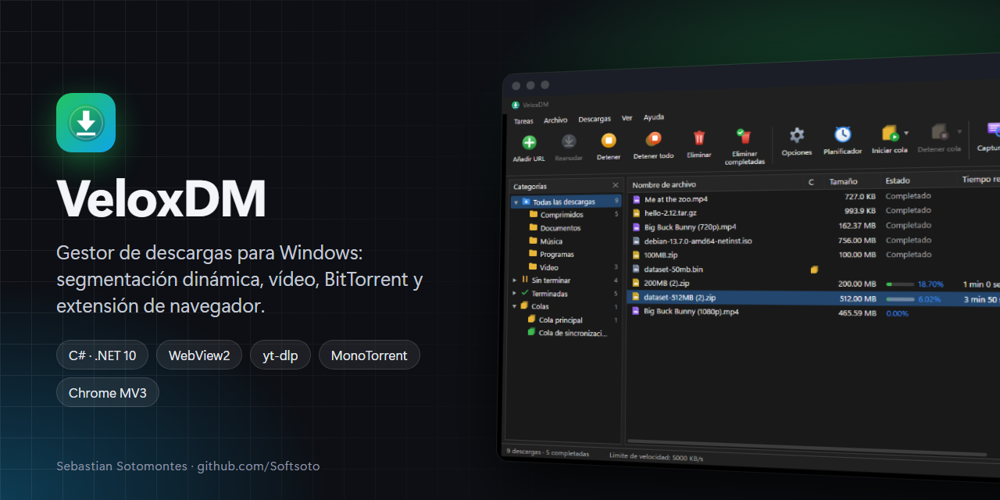
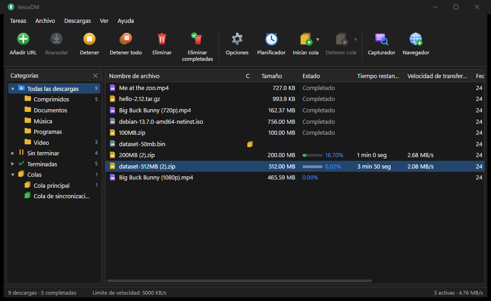
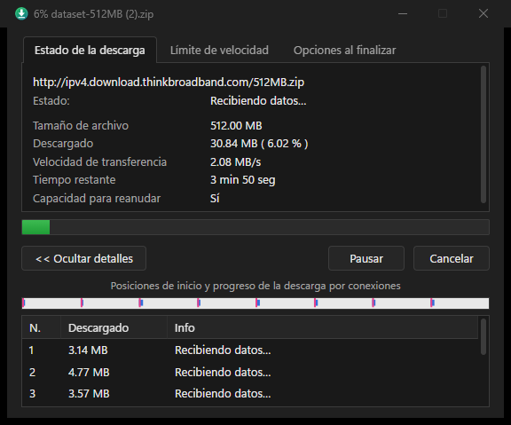
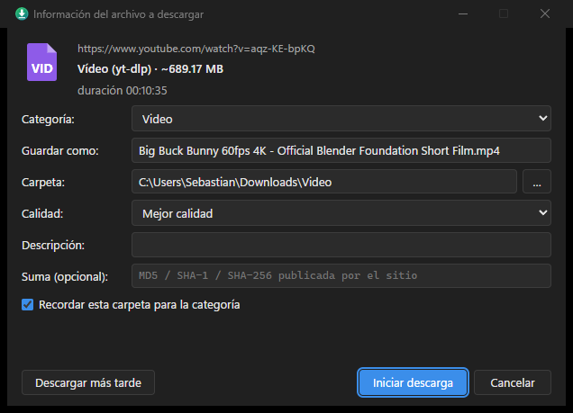
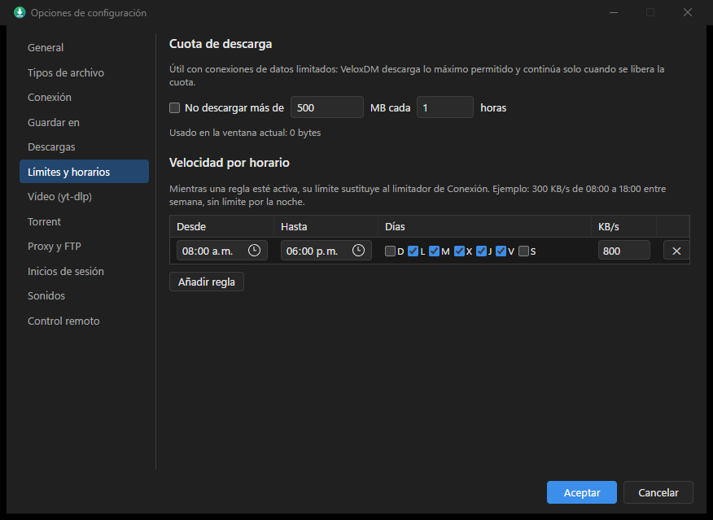

  

<h3 align="center">Gestor de descargas para Windows</h3>

Segmentación dinámica, colas, planificador, captura desde el navegador, vídeo y BitTorrent.

  <a href="https://sotomontes.com/#veloxdm"><b>Ver en sotomontes.com</b></a>

**Autor:** Sebastian Sotomontes · © 2026

> Esta página es solo una presentación del proyecto. El código y los instaladores son privados.

---

## Capturas

<table>
  <tr>
    <td colspan="2"> <b>Ventana principal</b>: categorías, colas y descargas simultáneas con velocidad y tiempo restante</td>
  </tr>
  <tr>
    <td width="50%"> <b>Progreso por conexiones</b>: cada segmento descarga en paralelo</td>
    <td width="50%"> <b>Vídeo</b>: YouTube y más de 1000 sitios, con selección de calidad</td>
  </tr>
  <tr>
    <td colspan="2"> <b>Límites y horarios</b>: cuota de descarga y velocidad por franja horaria</td>
  </tr>
</table>

## Funciones

- **HTTP/HTTPS y FTP** con hasta 32 conexiones y segmentación dinámica. Reanuda tras cortes, reinicios o apagones.
- **Vídeo** de YouTube y más de 1000 sitios, con calidad a elegir, MP4 o solo audio, además de HLS y DASH.
- **BitTorrent**: enlaces magnet y archivos `.torrent`, con selección de archivos.
- **Extensión de navegador** para Chrome, Edge, Brave, Vivaldi y Opera, que captura descargas y detecta vídeos.
- **Colas y planificador** con días, horas y acciones al terminar, cuota de descarga y velocidad por horario.
- **Capturador de enlaces**: encuentra los enlaces de un texto o una página, comprueba cuáles siguen en línea y los agrupa en paquetes.
- **Después de descargar**: verificación de sumas MD5, SHA-1 y SHA-256, descompresión y antivirus.
- **Control desde el móvil** en la red local con PIN, vigilancia del portapapeles y tema claro u oscuro.

## Tecnologías

C# · .NET 10 · WinForms · WebView2 · Extensión de navegador MV3

**Créditos:** usa yt-dlp, MonoTorrent y ffmpeg.

© 2026 Sebastian Sotomontes. Todos los derechos reservados.
